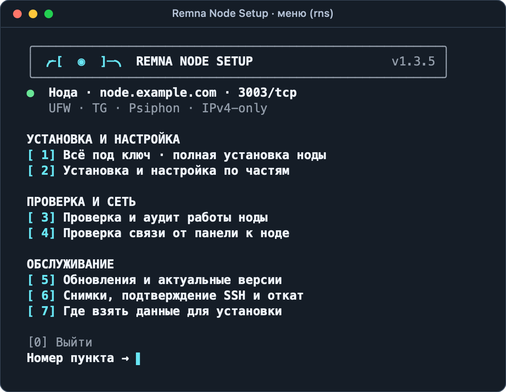

# Remna Node Setup

Мастер установки и обслуживания нод Remnawave. Настройте новую ноду, проверьте связь с панелью и управляйте компонентами из одного терминала.

[Последний релиз](https://github.com/AiGenik/remna-node-setup/releases/latest) · [Документация](docs/Обзор.md) · [Проверки GitHub Actions](https://github.com/AiGenik/remna-node-setup/actions/workflows/release.yml) · [MIT](LICENSE)

**Требования.** Отдельный VPS с Ubuntu 24.04 LTS и systemd на amd64 или arm64, доступ по SSH с правами администратора и действующая панель Remnawave.

## Быстрый старт

### 1. На VPS — установить мастер

Откройте Терминал на Mac или Linux. Замените `203.0.113.10` на IP ноды из кабинета хостинга и подключитесь к VPS.

```bash
ssh root@203.0.113.10
```

Введите пароль VPS, если SSH его запросит. Когда появится приглашение VPS вида `root@vps:~#`, вставьте следующую строку. Она установит мастер и откроет меню.

```bash
remna=$(curl -qfsSL --proto '=https' https://github.com/AiGenik/remna-node-setup/raw/HEAD/install.sh) && sudo bash -c "$remna"
```

Повторно меню на VPS открывается командой `sudo remna-node-setup`.

### 2. В меню — настроить ноду

1. В панели Remnawave откройте **Ноды → Управление → +** и укажите IP или домен VPS. В карточке ноды возьмите `Node Port` и `Secret Key`. [Где найти поля](docs/Установка.md#что-вводить)
2. В главном меню выберите **[1] Всё под ключ** для полной автоматической настройки новой ноды (нода, Nginx self-steal, BBR, отключение IPv6, UFW, Fail2Ban `DROP`, TrafficGuard, Psiphon для Gemini и ночные автообновления) или **[2] Установка и настройка по частям** для выбора и изменения отдельных компонентов (включая установку только ноды или смену порта VPN).
3. Для проверки доступности от сервера панели до ноды выберите **[4] Проверка связи от панели к ноде** (до или после установки), а для комплексной проверки работы — **[3] Проверка и аудит работы ноды**.



## Помощник remna-ssh

Помощник нужен, если вы хотите проверять связь **с сервера панели** и подтверждать изменения firewall из одного терминала. На VPS уже должен быть установлен мастер из шага 1.

1. Закройте меню кнопкой `0`, если оно открыто. В SSH-сеансе введите `exit`, чтобы вернуться в Терминал Mac или Linux.
2. На своём компьютере выполните одну строку. Она проверит SHA-256 и установит помощник без sudo.

```bash
remna=$(curl -qfsSL --proto '=https' https://github.com/AiGenik/remna-node-setup/raw/HEAD/install.sh) && bash -c "$remna" -- --client
```

Затем на компьютере откройте меню ноды через помощник.

```bash
~/.local/bin/remna-ssh --panel root@198.51.100.20 root@203.0.113.10
```

- После `--panel` укажите **SSH-адрес панели** или её имя из `~/.ssh/config`. Подключение к панели должно работать по ключу.
- Последним укажите **SSH-адрес ноды**. К ноде можно подключаться по паролю. Команда с `~/` работает из любой папки.
- Для проверки портов в меню нажмите Enter на вопросе о проверке с панели. Нужны Python 3.8+ на компьютере и Python 3 на панели. [Что показывает проверка](docs/Эксплуатация.md#проверка-связи-до-установки)

Для подтверждения SSH без проверки с панели достаточно `~/.local/bin/remna-ssh root@203.0.113.10`.

## Подтверждение SSH

Если меню открыто через `remna-ssh`, после изменения сетевых правил нажмите Enter. Помощник подтвердит доступ через новое SSH-соединение в том же терминале. Если доступ не подтверждён, VPS запустит автооткат. [Варианты подключения и ручное подтверждение](docs/Эксплуатация.md#подтверждение-ssh)

## Возможности

| Задача | Где найти |
| --- | --- |
| Полная установка новой ноды «Всё под ключ» | **[1] Всё под ключ** · нода (актуальный Xray/VLESS), Nginx self-steal, UFW, Fail2Ban (`DROP`), TrafficGuard, BBR, отключение IPv6, Psiphon и автообновления |
| Модульная установка и перенастройка по частям | **[2] Установка и настройка по частям** · только нода, Nginx/Caddy, UFW/SSH, [смена порта VPN](docs/Эксплуатация.md#смена-порта-vpn), BBR, IPv6, TrafficGuard, [Psiphon](docs/Psiphon.md), автозапуск защиты |
| Аудит ноды, живой тест трафика и Certbot dry-run | **[3] Проверка и аудит работы ноды** · `status`, `doctor`, `audit` (Gemini через Psiphon + прямой YouTube), `dns`, `logs` |
| Проверка связи от сервера панели до ноды | **[4] Проверка связи от панели к ноде** · двусторонний тест портов до или после установки |
| Актуальные версии и обновления компонентов | **[5] Обновления и актуальные версии** · онлайн-сравнение (`versions`), обновление скрипта, ноды, пакетов, Psiphon и TrafficGuard |

## Обновление

```bash
sudo remna-node-setup update tool
```

Команду обновления мастера выполняйте на VPS. Чтобы обновить помощник на компьютере, повторите шаг установки `remna-ssh`. В меню **Обновления → Обновить всё** можно обновить скрипт, ноду и установленные компоненты. Там же включаются ночные автообновления. [Что обновляется и как выполнить откат](docs/Эксплуатация.md#обновление)

## Документация и помощь

- [Установка](docs/Установка.md) · данные из панели, выбор компонентов и входящих портов.
- [Эксплуатация](docs/Эксплуатация.md) · диагностика, обновления и восстановление.
- [Разработка](docs/Разработка.md) · локальные проверки и сборка архива на Ubuntu.
- [История выпусков](https://github.com/AiGenik/remna-node-setup/releases) · изменения и файлы релизов.
- [GitHub Issues](https://github.com/AiGenik/remna-node-setup/issues) · сообщите версию скрипта, версию Ubuntu и команду с ошибкой. Перед публикацией удалите ключи, пароли и токены из вывода.
- [Безопасность](SECURITY.md) · конфиденциальное сообщение об уязвимости.

Для работы в Obsidian откройте папку `docs` как хранилище. Начните с заметки [Обзор](docs/Обзор.md).
